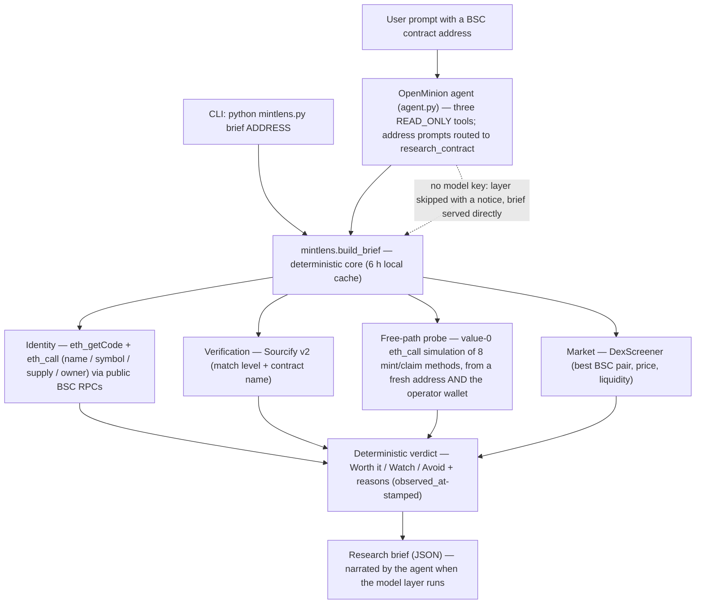

# MintLens

A read-only research agent for BSC free-mint opportunities, built on the
[OpenMinion](https://github.com/OpenMinion/openminion) SDK for
Cortensor Hackathon #5.

Give MintLens a BSC contract address and it returns a grounded research brief:
what the contract is, whether its source is verified, whether a free
mint/claim path appears reachable, whether a market exists yet — and a
calibrated verdict (**Worth it** / **Watch** / **Avoid**). Every fact in the brief comes from a live
read-only check; the language model only orchestrates the tools and narrates
their output.

MintLens is a miniature of a production verification pipeline used to screen
Agent-ID free mints: it never signs, never sends a transaction, and treats a
passing simulation as a *signal*, never as proof.

## Run it in 2 minutes

```bash
python3 -m venv .venv && source .venv/bin/activate
pip install -r requirements.txt

# 1) Deterministic brief — no API key, no model needed:
python mintlens.py brief 0x48c3ae8e8129efa9d20800ac8932d8b51f85c0f0
#    → Moth Club brief, verdict "Worth it"
#      (sample output: examples/sample-brief-moth-club.json)

# 2) End-to-end smoke test of the same pipeline (asserts structure + verdict):
python smoke_test.py

# 3) Optional — the model-backed agent (needs a provider config + key):
openminion config init --provider openai   # creates .openminion/agents.json
cp .env.example .env                       # then put your key in .env
set -a; source .env; set +a
python agent.py "Research this BSC contract: 0x48c3ae8e8129efa9d20800ac8932d8b51f85c0f0"
```

No key handy? `python agent.py "Research 0x…"` still runs: it prints that
the model layer is skipped and serves the deterministic brief instead of
crashing. Key sources (env var, or a local key file) are documented in
[.env.example](.env.example); provider/model setup details are in the
Quickstart section below.

## Architecture



## How it works

```
user prompt ──► OpenMinion Agent (agent.py)
                  │  calls tools, narrates results
                  ▼
        ┌─────────────────── mintlens.py (deterministic core) ───────────────────┐
        │ research_contract(address)                                             │
        │   1. Identity        eth_call: name / symbol / totalSupply / owner   │
        │   2. Verification    Sourcify v2: match level + contract name        │
        │   3. Free-path probe value-0 eth_call simulation of 8 common         │
        │                      mint/claim methods, from TWO perspectives:      │
        │                      a fresh address AND the operator wallet         │
        │   4. Market          DexScreener: best BSC pair, price, liquidity    │
        │   5. Verdict         deterministic rules over the four checks        │
        └──────────────────────────────────────────────────────────────────────┘
```

The dual-perspective probe is the interesting part: one simulation sender
conflates three very different states — *no free path*, *free path exists*,
and *free path exists but this wallet's quota is already spent*. Probing from
both a fresh address and the operator wallet separates them. It also exposes a
whole family the generic probe cannot see: Agent-ID-gated mints revert from
any plain address, so MintLens reports "not detected" rather than "does not
exist", and never condemns a verified contract just because the probe came
back empty.

Verdict rules (deterministic, in `build_brief`):

- **Worth it** — a free path passes simulation *and* the source is verified.
- **Watch** — any single positive signal (verified source, a market, or a
  free-path signal) without the full combination.
- **Avoid** — no code at the address, or no positive signal at all.

Briefs are cached locally for 6 hours (`.mintlens_cache.json`) so repeated
questions don't re-hammer public RPCs.

## OpenMinion building blocks used

- **`Agent` facade + `@tool`** — three tools (`research_contract`,
  `check_verification`, `check_market`) wrap the deterministic core.
- **Tool policy annotations** — the tools are declared
  `@tool(min_scope="READ_ONLY", idempotent=True)`, which is what makes the
  runtime's policy engine classify them as read / no-side-effects /
  reversible. Without the annotation, a bare `@tool` defaults to a WRITE_SAFE
  scope and the run stops at an interactive confirmation prompt.
- **Pluggable provider config** (`.openminion/agents.json`) — developed
  against the `echo` provider for plumbing, then run for real on **Gemini**
  through Google's official OpenAI-compatible endpoint plugged into the
  `openai` provider slot (the SDK ships no native Gemini provider in
  0.1.18 — see FINDINGS #7). Any OpenAI-compatible provider works the same way.
- **Sessions with explicit `thread_id`** — `agent.run(..., thread_id=
  "mintlens-en")` resumes conversation history across processes;
  `session_id` alone does not (FINDINGS #10).
- **Freshness verification** — tool results are returned as structured dicts
  stamped with an `observed_at` timestamp, satisfying the runtime's
  dated-evidence requirement for time-sensitive answers (FINDINGS #11).
- **Runtime timeout tuning** — chat/API/brain turn timeouts raised in config
  for slow networks (FINDINGS, config note).

What we deliberately did **not** enable: the SDK's blockchain signing tools
and SSH tools exist in the runtime, but MintLens runs a read-only profile —
no keys, no signing, no transactions. Our three tools only perform `eth_call`
reads and public API GETs.

## Quickstart

```bash
python3 -m venv .venv && source .venv/bin/activate
pip install openminion==0.1.18 requests pycryptodome

# deterministic core, no model needed:
python mintlens.py brief 0x8b8e59c014eb3e229e043ae8f3b0d7e201d21db0

# agent (needs a model provider):
openminion config init --provider openai   # or openrouter / groq / ...
# edit .openminion/agents.json: set the provider's base_url + model,
# and export the key under the provider's api_key_env name, e.g.
#   export OPENAI_API_KEY=...   (a Gemini key + Google's OpenAI-compatible
#                                base_url works — see FINDINGS #7)
python agent.py "Research this BSC contract: 0x8b8e59c014eb3e229e043ae8f3b0d7e201d21db0"

# follow-up in the same thread (history resumes):
python agent.py "Which contract did I just ask about, and what was the verdict?"
```

Expected output for the example contract (Kitebots, an Agent-ID-gated NFT
collection the operator had already minted): identity read on-chain, Sourcify
*exact match*, no free path detected from a plain address (the gate is
identity-based — the brief says so), no DEX pair yet, verdict **Watch**.

## Example run (real model, Gemini 3.1 Flash Lite)

> **Identity:** Kitebots (KITE), total supply 668, owner `0x4e9b…08dba`
> **Sourcify:** verified (exact match)
> **Free-mint path signal:** none detected — all value-0 simulations reverted
> from the test address; the path may be identity-gated
> **Market:** no BSC pair on DexScreener
> **Verdict: Watch**

A second process then answered "which contract did I ask about, and what was
the verdict?" correctly from thread history alone.

## Runtime Proof

A real, unedited run of the deterministic pipeline (fresh reads, no cache),
captured 2026-11-06 for Moth Club — the ground-truth contract used by the
smoke test:

```bash
$ python mintlens.py brief 0x48c3ae8e8129efa9d20800ac8932d8b51f85c0f0 --fresh
```

Excerpt of the output (fields trimmed; full transcript in
[examples/runtime-proof-moth-club.txt](examples/runtime-proof-moth-club.txt)):

```json
{
  "address": "0x48c3ae8e8129efa9d20800ac8932d8b51f85c0f0",
  "checked_at": "2026-11-06T07:16:21Z",
  "contract": { "name": "Moth Club", "symbol": "MOTH", "total_supply_raw": 408 },
  "verification": { "verified": true, "match": "exact_match", "name": "MothClub" },
  "free_paths": { "has_free_path_signal": true, "methods_ok": ["mint(uint256)=1"],
                  "operator_wallet_methods_ok": [] },
  "verdict": "Worth it"
}
```

Note the dual-perspective result: the free path passes from a fresh address
but not from the operator wallet — this wallet's free quota is already spent
(it minted earlier), which is exactly the distinction the probe exists to
make. The same brief as structured JSON is in
[examples/sample-brief-moth-club.json](examples/sample-brief-moth-club.json).

Replay / verification: [smoke_test.py](smoke_test.py) re-runs this pipeline
and asserts the brief's structure and verdict against ground truth —
**15/15 checks pass, exit code 0** (`SMOKE TEST PASSED — 15 checks, verdict
'Worth it'`; pass `--fresh` to force live reads instead of the cache).

## Batch briefs and cross-process memory

Two workflows built on the same core, both with captured real output:

**Batch mode** — brief several contracts in one run:

```bash
python mintlens.py batch 0x48c3ae8e8129efa9d20800ac8932d8b51f85c0f0 0x8b8e59c014eb3e229e043ae8f3b0d7e201d21db0
```

`build_batch` runs `build_brief` sequentially (reusing the 6 h cache) and
prints a comparison table — name, symbol, verified?, free-path signal,
verdict — followed by the full briefs as one JSON object. One bad address
never kills the batch: its slot becomes an inline error entry and its
table row shows `ERROR` with the reason. Real run (two ground-truth
contracts + one malformed address):
[examples/batch-output.txt](examples/batch-output.txt) — Moth Club →
**Worth it**, Kitebots → **Watch**, `0x123` → inline error, batch completes.

**Cross-process memory** — `python memory_demo.py` runs `agent.py` twice
as two separate OS processes that share only the OpenMinion thread
(`thread_id="mintlens-en"`). Process 1 researches Moth Club by address;
process 2 — a new process whose prompt contains *no* address — is asked
for the verdict and the free-path result, and answers both correctly
from the thread history alone. This is the SDK behaviour behind
FINDINGS #10 (`session_id` alone does not resume history; an explicit
`thread_id` does), packaged as a replayable demo. Full transcript:
[examples/memory-demo-transcript.txt](examples/memory-demo-transcript.txt).

## Demo video

[mintlens-demo.mp4](mintlens-demo.mp4) (2 min 31 s, 1920×1080, in this
repo) — built from **real asciinema recordings** of the product running
live, with English voice narration, styled subtitles, an original music
track mixed under the voice, and motion design on top. The motion layer
is built in **Remotion** (React + TypeScript): every entrance, camera
move, and highlight runs on spring physics or bezier easing — a
letter-by-letter wordmark, word-by-word headline reveals, staggered
status chips, a spring camera push-in and eased pan over the terminal
footage, self-drawing verdict highlights, staggered findings cards, and
a segment progress indicator. Scenes: a live CLI brief of
Moth Club ending in the **Worth it** verdict, a batch comparison (Moth
Club **Worth it** vs Kitebots **Watch**), an explanatory card for the
cross-process memory workflow (twelve live re-recording attempts on
2026-11-06 were blocked by the OpenMinion runtime's freshness verifier;
the genuine earlier transcript ships in
[examples/memory-demo-transcript.txt](examples/memory-demo-transcript.txt)
and the workflow replays via `python memory_demo.py`), and a closing card
on the 13 SDK findings. Waiting time inside the live runs is
time-compressed in editing and labelled on screen; no output is retyped
or mocked up. Segment list and production notes are in [DEMO.md](DEMO.md);
the full narration script and scene provenance are in
[DEMO-SCRIPT-v7.md](DEMO-SCRIPT-v7.md).

## Safety & Constraints

MintLens is a research tool with a hard read-only boundary. Explicitly:

- **It refuses to sign anything.** There is no private-key handling and no
  signing code path anywhere in `mintlens.py` or `agent.py`; no key is ever
  loaded for transaction purposes.
- **It never sends a transaction.** The only chain access is `eth_call` /
  `eth_getCode` JSON-RPC and HTTPS GETs to the Sourcify and DexScreener
  public APIs. Every simulation is a value-0 `eth_call` — the "from"
  address is just a field on a read, and no funds can move.
- **It never approves, sets allowances, or writes to a wallet.** No
  `approve`-style call exists in the codebase; the operator address appears
  only as a simulation sender so the probe can tell "no free path" apart
  from "this wallet's quota is spent".
- **Its tools are policy-scoped read-only.** All three agent tools are
  declared `@tool(min_scope="READ_ONLY", idempotent=True)`, and the agent is
  constructed with exactly those three tools — nothing else.
- **The SDK's signing and SSH tools are not enabled.** They exist in the
  OpenMinion runtime, but MintLens runs a read-only profile and never wires
  them in.
- **Keys stay local.** The model provider key is read from an environment
  variable or a local file (`.openminion/gemini.key`, gitignored); it is
  loaded into the process environment only, never printed, logged, or
  committed. `.env`, `*.key`, and `.openminion/` are all in `.gitignore`.
- **The model cannot invent or transact.** The system prompt requires the
  agent to base answers strictly on tool output and forbids suggesting it
  can send a transaction; the verdict itself is deterministic code in
  `build_brief`, not model opinion. A passing simulation is reported as a
  *signal*, never as proof that a mint would succeed.

## Findings

Building-block notes, rough edges, and feedback for the OpenMinion team are
in [FINDINGS.md](FINDINGS.md) — 13 numbered findings from building and
running MintLens, including the ones referenced above.

## How this maps to the Hackathon #5 rubric

| Criterion | Weight | Where it is satisfied in this repo |
|---|---|---|
| Working functionality | 25% | The deterministic brief pipeline (`mintlens.build_brief`) running live end-to-end — see the Runtime Proof section above and [examples/runtime-proof-moth-club.txt](examples/runtime-proof-moth-club.txt); the demo video (`mintlens-demo.mp4`, [DEMO.md](DEMO.md)); ground-truth contracts exercised in the smoke test |
| OpenMinion SDK usage | 20% | [agent.py](agent.py): `Agent` facade, three `@tool` functions with policy annotations, pluggable provider config, explicit `thread_id` sessions, `observed_at` freshness stamps — inventoried in "OpenMinion building blocks used" above |
| Reproducibility & demo quality | 20% | "Run it in 2 minutes" quickstart; pinned [requirements.txt](requirements.txt); [.env.example](.env.example); the no-key fallback in `agent.py`; [smoke_test.py](smoke_test.py) as a replay check (15/15, exit 0); [examples/sample-brief-moth-club.json](examples/sample-brief-moth-club.json) |
| Building-block findings / SDK feedback | 25% | [FINDINGS.md](FINDINGS.md) — 13 numbered findings from building and running on the SDK, including the ones referenced throughout this README |
| Relevance | 10% | The brief screens exactly the problem this track is about — BSC free-mint / Agent-ID-gated opportunities — as a miniature of a production verification pipeline; scope and blind spots stated plainly in the Limitations section below |

## Limitations (honest list)

- Identity-gated free mints (e.g. Agent ID) under-detect: the probe can say
  "not detected", never "proven absent", for that family.
- A passing simulation is a signal, not a mint guarantee — production use
  needs the full gate (contract from the project's own site, quota reads,
  transaction preview) before anything is signed.
- Public RPC / API rate limits apply; the 6 h cache mitigates repeat checks.
